

## 👋 About Me

I build backend systems and AI agents end to end, from distributed workers and event queues to voice agents and LLM inference. When I'm not shipping, I'm solving competitive programming problems.

- 🏢 **SWE @ E2E Networks:** Backend · Distributed Systems · Agentic AI
- 🤖 **Into:** Voice Agents · MCP · LangGraph · RAG · LLM Inference
- ⚙️ **Stack:** Python · Django · FastAPI · Kubernetes · RabbitMQ · Temporal · AWS
- 🏆 **Knight on LeetCode** · **4★ CodeChef** · **Specialist on Codeforces**
- 📫 **Reach me:** [kumaraman.sde@gmail.com](mailto:kumaraman.sde@gmail.com) · [LinkedIn](https://linkedin.com/in/aman-kumar727)

## 🚀 Featured Projects

Click a card to open the project. Try two of them live: [Ringvi](https://ringvi.vercel.app) and [Journey Engine](https://nudgio.vercel.app).

<a href="https://github.com/ak7270090/voice-agent#gh-light-mode-only">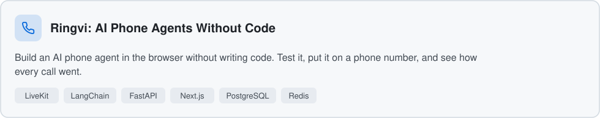</a><a href="https://github.com/ak7270090/voice-agent#gh-dark-mode-only">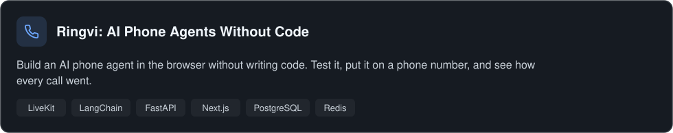</a>

<a href="https://github.com/ak7270090/user-engagement#gh-light-mode-only">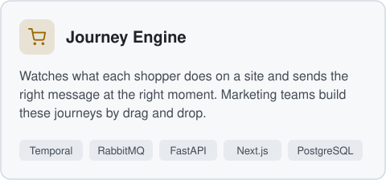</a><a href="https://github.com/ak7270090/user-engagement#gh-dark-mode-only">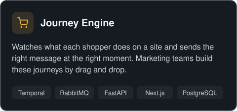</a> <a href="https://github.com/ak7270090/ai-oncall-agent#gh-light-mode-only">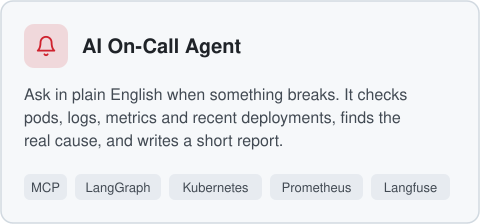</a><a href="https://github.com/ak7270090/ai-oncall-agent#gh-dark-mode-only">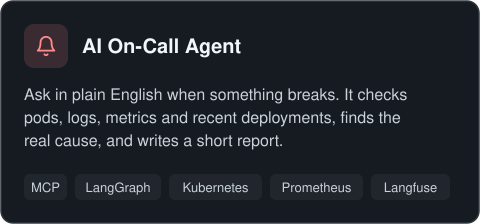</a>

<a href="https://github.com/ak7270090/inference-engine-from-scratch#gh-light-mode-only">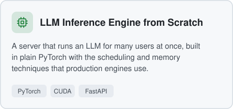</a><a href="https://github.com/ak7270090/inference-engine-from-scratch#gh-dark-mode-only">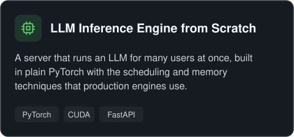</a> <a href="https://github.com/ak7270090/mcp-server-scale#gh-light-mode-only">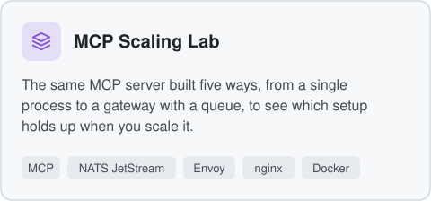</a><a href="https://github.com/ak7270090/mcp-server-scale#gh-dark-mode-only">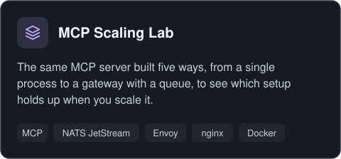</a>

<a href="https://github.com/ak7270090/video-meet#gh-light-mode-only">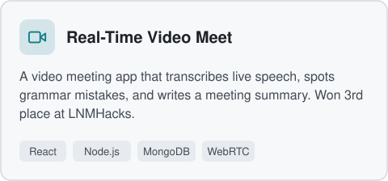</a><a href="https://github.com/ak7270090/video-meet#gh-dark-mode-only">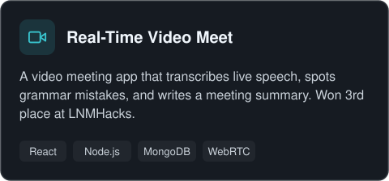</a> <a href="https://github.com/ak7270090/Real-time-Voice-AI-Orchestration#gh-light-mode-only">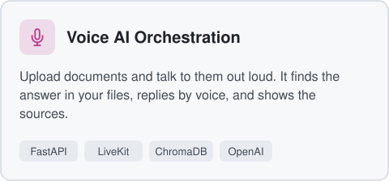</a><a href="https://github.com/ak7270090/Real-time-Voice-AI-Orchestration#gh-dark-mode-only">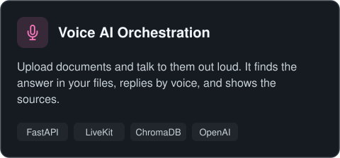</a>

<a href="https://github.com/ak7270090/graph-rag#gh-light-mode-only">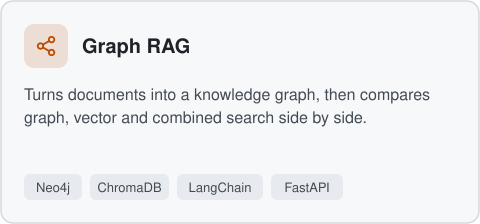</a><a href="https://github.com/ak7270090/graph-rag#gh-dark-mode-only">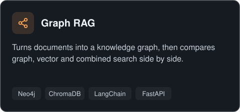</a> <a href="https://github.com/ak7270090/dl-fundamentals#gh-light-mode-only">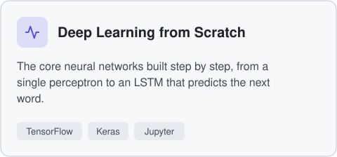</a><a href="https://github.com/ak7270090/dl-fundamentals#gh-dark-mode-only">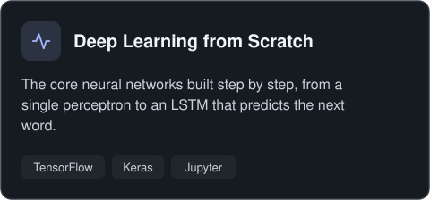</a>

## 🛠️ Technical Skills

<table>
  <tr>
    <td><b>AI / LLM</b></td>
    <td>        </td>
  </tr>
  <tr>
    <td><b>Languages</b></td>
    <td>   </td>
  </tr>
  <tr>
    <td><b>Backend</b></td>
    <td>       </td>
  </tr>
  <tr>
    <td><b>Infrastructure</b></td>
    <td>       </td>
  </tr>
  <tr>
    <td><b>Databases</b></td>
    <td>    </td>
  </tr>
</table>

## 🏆 Competitive Programming

> **800+ problems solved** across LeetCode, CodeChef, and Codeforces.

| Platform | Handle | Rating | Rank |
|:--------:|:------:|:------:|:----:|
| 🟡 **LeetCode** | [ak7270090](https://leetcode.com/ak7270090) | **1998** | 🎖️ Knight (Top 3%) |
| 🟤 **CodeChef** | [ak7270090](https://www.codechef.com/users/ak7270090) | **1811** | ⭐⭐⭐⭐ 4-Star (Top 2%) |
| 🟣 **Codeforces** | [dustin](https://codeforces.com/profile/dustin) | **1407** | 🔵 Specialist |

Strong in **Dynamic Programming**, **Binary Search**, **Graphs**, **Greedy**, and **Data Structures**.
